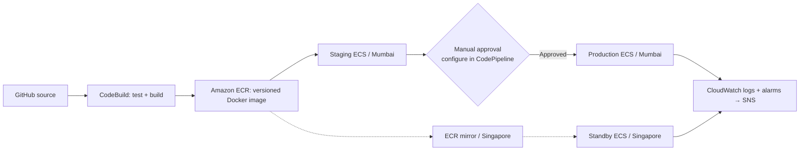

# AWS DevOps Infrastructure & Deployment | Logicworks Certification Project

**Terraform · Docker · Amazon ECS/Fargate · Amazon ECR · AWS CodeBuild/CodePipeline · CloudWatch · SNS · Multi-region design**

> **Project status: reference implementation / learning project.** This repository contains runnable application code, Terraform infrastructure definitions, test scripts, and a documented AWS release design. It **does not prove** that cloud resources, a full AWS CodePipeline, Route 53 failover, or disaster recovery were deployed and tested. The original 14-page report explicitly describes a proposed design. The companion implementation ZIP described in that report was not uploaded; the source files in this repository are a newly prepared starter based on the report and still need account-level verification. See [the source report](docs/source/Logicworks_AWS_DevOps_Final_Certification_Project.pdf).

## Project overview (in simple words)

Imagine your company has a website that developers update regularly. A manual deployment is risky: a wrong command might break the site, and recovering after a major outage can take time. This project proposes a more repeatable process:

1. **Terraform** creates the network and supporting AWS infrastructure from code.
2. **Docker** packages a tiny web application into the same portable image for every environment.
3. **Amazon ECR** stores the container image; **ECS on AWS Fargate** runs the application in private subnets.
4. **CodeBuild** checks the code and builds the image; **CodePipeline** is intended to deploy to staging, require a human's approval, and then deploy to production.
5. **CloudWatch and SNS** provide application logs and notifications about certain errors.
6. A second AWS Region is prepared as a **recovery foundation**. Traffic failover and any required data recovery must be added and tested separately.

### The business problem

Reproducing environments by hand can cause inconsistent settings and difficult deployments. Logicworks needs a design for predictable infrastructure, safer releases, visibility into failures, and a documented recovery path. The technical choices here are an example solution to the assignment, not proof of an existing Logicworks production environment.

### What you will learn

| Technology | Simple explanation | Used here for |
| --- | --- | --- |
| **Git / GitHub** | Tracks what changed and when | Store project files and review changes |
| **Python / Flask** | Small example web service | Endpoints `/`, `/health`, `/ready` |
| **Docker** | Packages an app with its runtime | Build one container image |
| **Terraform** | Writes cloud setup instructions as code | Create VPC, subnets, NAT, security groups, ALB, ECS and alarms |
| **Amazon VPC** | Private network inside AWS | Separate public entry points from private application tasks |
| **ALB** | Distributes web requests to healthy app tasks | Route HTTP traffic and check `/health` |
| **Amazon ECS / Fargate** | Runs and manages containers | Run app tasks without maintaining EC2 hosts |
| **Amazon ECR** | Container image registry | Store the built image in each region |
| **AWS CodeBuild** | Executes build and test jobs | Tests, Docker build, smoke check, push to ECR |
| **AWS CodePipeline** | Coordinates release steps | Intended Source → Build → Stage → Approval → Production workflow |
| **CloudWatch / SNS** | Observes problems and sends notifications | Logs, HTTP 5xx alarm, email notification option |
| **Route 53** | DNS service | Planned failover routing; **not provisioned here** |

## Architecture at a glance



**Proposed deployment regions:** Mumbai (`ap-south-1`) for staging and primary production, Singapore (`ap-southeast-1`) for a warm standby. Each environment is a separate Terraform root and state, containing a two-AZ VPC, ALB, private Fargate service, two NAT gateways, and basic monitoring. **The diagram shows the intended workflow, not a completed AWS pipeline.**

For a larger architecture diagram and technical explanation, see [Architecture](docs/ARCHITECTURE.md).

## Repository contents

```text
logicworks-aws-devops-project/
├── README.md                         # This overview + quick start
├── compose.yaml                      # Docker Compose local build and execution
├── requirements-dev.txt              # Optional report/test dependencies
├── buildspec.yml                     # AWS CodeBuild commands and image artifact
├── buildspec.smoke.yml               # Staging /health gate for a separate CodeBuild job
├── .github/workflows/ci.yml         # GitHub checks (not AWS production deploy)
├── app/
│   ├── app.py                        # Flask application with health endpoints
│   ├── requirements.txt              # Python libraries
│   ├── Dockerfile                    # Container definition
│   └── .dockerignore
├── tests/
│   ├── test_app.py                   # Python unit tests
│   └── test_replication_script.py    # Offline Bash/ECR digest checks
├── terraform/
│   ├── modules/regional_app/         # Shared VPC, ECS, ALB, IAM, CloudWatch, SNS module
│   └── environments/
│       ├── stage/                    # Staging; Mumbai
│       ├── prod-primary/             # Primary; Mumbai
│       └── prod-secondary/           # Recovery; Singapore
│           # Each environment contains main.tf, versions.tf,
│           # terraform.tfvars.example and backend.hcl.example
├── scripts/
│   ├── docker_runner.py              # Python build/run/test/log/cleanup utility
│   ├── preflight.py                  # Local tool availability check
│   ├── check_endpoint.py             # Real HTTP checks and JSON evidence
│   ├── generate_validation_report.py # Markdown + JSON report
│   ├── export_validation_pdf.py      # PDF export (optional ReportLab)
│   ├── build_push_ecr.sh             # Build/push to regional ECR
│   ├── terraform_check.sh            # Backend-free Terraform check
│   ├── run_docker.ps1                # Docker smoke test on Windows
│   ├── check_local.sh                # Build Docker + test /health
│   ├── check_deployment.sh           # Test the deployed ALB URL
│   ├── create_state_bucket.sh        # Optional S3 state bucket bootstrap
│   ├── create_ecr_repositories.sh    # Create/confirm regional ECR repositories
│   ├── verify_replication.sh         # Compare image digests across regions
│   ├── mirror_source.sh              # Push Git branches/tags to a configured mirror
│   └── write_secondary_imagedefinitions.sh   # Generate verified secondary ECR deploy artifact
└── docs/
    ├── ARCHITECTURE.md
    ├── DEPLOYMENT_GUIDE.md
    ├── REQUIREMENT_TRACEABILITY.md
    ├── SECURITY_AND_COST.md
    ├── TEST_AND_EVIDENCE.md
    ├── TROUBLESHOOTING.md
    ├── GITHUB_UPLOAD.md
    ├── RUN_ALL_SCRIPTS.md
    └── source/Logicworks_AWS_DevOps_Final_Certification_Project.pdf
```

## Start here: run the app locally (no AWS required)

**Requirements:** Python 3.12+, Git, an internet connection for installing packages, and optionally Docker Desktop. For Windows, use VS Code and **Git Bash or WSL** for the `.sh` scripts.

1. Open a terminal inside the repository folder.
2. Create and activate a Python environment:

   ```bash
   python -m venv .venv
   source .venv/bin/activate
   # Windows PowerShell instead: .venv\Scripts\Activate.ps1
   ```

3. Install dependencies and run tests:

   ```bash
   python -m pip install -r app/requirements.txt
   python -m unittest discover -s tests -v
   ```

4. Start the app:

   ```bash
   python app/app.py
   ```

5. In a second terminal, visit or check these endpoints:

   ```bash
   curl http://127.0.0.1:8080/
   curl http://127.0.0.1:8080/health
   curl http://127.0.0.1:8080/ready
   ```

   The health endpoint should show `{"status":"ok"}`. **This is an example of expected output, not proof of a live AWS deployment.**

6. If Docker is installed and running, test the packaged application:

   ```bash
   bash scripts/check_local.sh
   ```

   The script builds the image, starts a temporary container on localhost port **18080**, checks `/health`, and removes the container.

## Next: deploy to an AWS learning account (costs money)

**Do not run `terraform apply` until you have reviewed costs, IAM, S3 state, and networking.** Each environment defines **two NAT gateways**, an ALB, Fargate tasks, and other billable services. All three environments together can incur substantial recurring charges even with no users. An AWS Free Tier account does **not** mean these services are free.

Follow [Deployment Guide](docs/DEPLOYMENT_GUIDE.md) for every command and the correct order. The short version:

1. Configure AWS CLI (`aws configure` or an SSO profile) and confirm your account using `aws sts get-caller-identity`.
2. Set a cost budget; create a restricted Terraform S3 state bucket.
3. Create ECR repositories; configure image replication **before publishing a new image**.
4. Build and push the demo Docker image to ECR.
5. Configure `backend.hcl` and `terraform.tfvars` **separately** for staging, primary and secondary.
6. Start with **staging only**: `terraform init`, `validate`, `plan`, then review the plan before `apply`.
7. Use the ALB health URL to test the deployment; capture actual output.
8. Only after that, set up CodeBuild, CodePipeline, staging tests, manual approval and production deploy actions in AWS.
9. If you decide to test recovery, implement DNS failover and handle application data first. Record RTO/RPO from an actual drill.
10. Use the documented **destroy** procedure when the lab is finished, and inspect the AWS account for remaining charges.


## Run every script and generate reports

**New: one place for all runnable files:** [All Scripts and Commands](docs/RUN_ALL_SCRIPTS.md). This includes Python tools, Terraform, Docker Desktop/Compose, Windows PowerShell, ECR publishing, regional image checks and evidence reports.

### Quick local checks (Windows, macOS or Linux)

```bash
python scripts/preflight.py
python -m pip install -r app/requirements.txt
python -m unittest discover -s tests -v
python scripts/docker_runner.py all
python scripts/generate_validation_report.py --docker-smoke
```

**Docker is required** for the Docker commands. If you are on Windows, start Docker Desktop first. To use Docker Compose instead:

```bash
docker compose up --build -d
python scripts/check_endpoint.py --url http://127.0.0.1:18080
docker compose logs --tail 50
docker compose down
```

For Terraform syntax and provider validation (without creating AWS resources):

```bash
bash scripts/terraform_check.sh
```

### Reports included

- [Original 14-page PDF certification report](docs/source/Logicworks_AWS_DevOps_Final_Certification_Project.pdf)
- [Actual local verification snapshot (Markdown)](reports/LOCAL_VERIFICATION_REPORT.md) and [printable PDF](reports/LOCAL_VERIFICATION_REPORT.pdf)
- [Implementation status and remaining work](reports/PROJECT_IMPLEMENTATION_STATUS.md)
- [AWS deployment and test report template](reports/DEPLOYMENT_TEST_REPORT_TEMPLATE.md)
- [Report generation instructions](reports/README.md)

Reports explain precisely what was tested and what remains unverified. The ZIP **does not include a prebuilt Docker image**: the `Dockerfile` and Python/PowerShell/Bash/Compose commands build and execute the image on a machine with Docker installed.

## Assignment completion: what is included and what is not

| Area | Repository files | AWS setup / evidence still needed |
| --- | --- | --- |
| Infrastructure as Code | Terraform VPC/ALB/ECS/monitoring module and 3 environments | Real `plan`/`apply` results, state checks |
| Containers and scaling | Python app, Dockerfile, ECS + primary autoscaling policy | ECR push, task health and load test |
| CI/CD | CodeBuild buildspec and setup instructions | Actual CodePipeline/CodeConnections configuration |
| Release approval | Described Stage → Approval → Production workflow | Actual gated execution with approval/rejection evidence |
| Cross-region images | ECR creation and digest verification helpers | ECR replication rule and observed image copies |
| Cross-region Git | Non-destructive source mirror helper | Second regional Git host and SHA comparison |
| Observability | Basic CloudWatch log group, 5xx alarm, SNS | Email confirmation, delivered alert and dashboard additions |
| Disaster recovery | Separate secondary region foundation | Route 53 failover, data replication, recovery test |

The complete seven-item mapping is in [Requirement Traceability](docs/REQUIREMENT_TRACEABILITY.md).

## Documentation: choose what you need

- **[Architecture walkthrough](docs/ARCHITECTURE.md):** network, pipeline, monitoring, two kinds of replication, what is intentionally missing.
- **[Full AWS deployment guide](docs/DEPLOYMENT_GUIDE.md):** prerequisites, region configuration, ECR push, Terraform, CodeBuild/CodePipeline setup, cleanup.
- **[Requirement checklist](docs/REQUIREMENT_TRACEABILITY.md):** each assignment requirement and its proof.
- **[Security and cost guide](docs/SECURITY_AND_COST.md):** practical risks and safe defaults for a lab.
- **[Test and evidence plan](docs/TEST_AND_EVIDENCE.md):** commands, screenshots, acceptance criteria, and progress log.
- **[Troubleshooting](docs/TROUBLESHOOTING.md):** fixes for common failures.
- **[GitHub upload instructions](docs/GITHUB_UPLOAD.md):** step-by-step for `Pacman006` (both new and existing repositories).

## GitHub-ready presentation

**Suggested repository:** `aws-devops-multi-region-ecs-terraform`  
**Suggested description:** `AWS DevOps certification project: Terraform-managed ECS/Fargate infrastructure, Docker delivery, CodeBuild pipeline starter, CloudWatch monitoring, and multi-region recovery design.`  
**Topics:** `aws`, `devops`, `terraform`, `docker`, `amazon-ecs`, `fargate`, `codepipeline`, `codebuild`, `cloudwatch`, `infrastructure-as-code`, `multi-region`, `cicd`

This is a **certification design and implementation starter**, not a claim of operational responsibility for a customer production workload. After running the environment, replace "not yet verified" statements with genuine, dated evidence of what you executed.

## References

- [Original Logicworks project report (PDF)](docs/source/Logicworks_AWS_DevOps_Final_Certification_Project.pdf)
- [Terraform S3 backend, native state locking](https://developer.hashicorp.com/terraform/language/backend/s3)
- [AWS CodePipeline ECS image definitions](https://docs.aws.amazon.com/codepipeline/latest/userguide/file-reference.html)
- [AWS CodePipeline manual approval](https://docs.aws.amazon.com/codepipeline/latest/userguide/approvals.html)
- [AWS CodePipeline cross-region actions](https://docs.aws.amazon.com/codepipeline/latest/userguide/actions-create-cross-region.html)
- [Amazon ECR cross-region replication](https://docs.aws.amazon.com/AmazonECR/latest/userguide/replication.html)

---

**Learning note:** This repository demonstrates how the components are intended to work together. A verified AWS deployment requires using your own AWS account, checking security and billing, and recording actual test outcomes.
